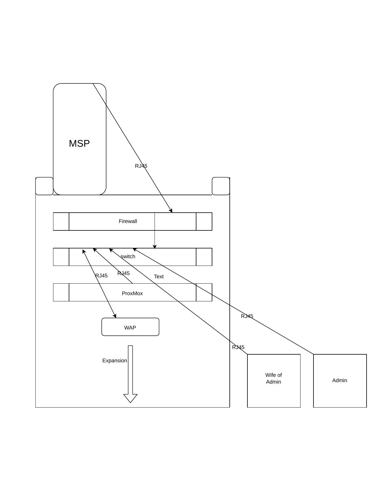

# Network — Current State

**Last verified:** 2026-10-28

The operational reference for the lab as built. This is the document to open
first when something breaks or when picking the build back up after a gap.



*Source diagram: [`home-network-topology.pdf`](home-network-topology.pdf) —
drawn in draw.io. "MSP" on the diagram is the ISP-provided Verizon 5G router.*

---

## Topology

```
Internet
   │  (5G cellular — no copper to the premises)
   ▼
Verizon 5G Router ................ 192.168.1.0/24   [ISP equipment]
   │
   │  RJ45 → OPNsense WAN (re1)
   ▼
OPNsense Firewall ................ 192.168.10.1/24  [LAN gateway, DHCP, DNS]
   │
   │  RJ45 from LAN (re0) → switch port 7
   ▼
Omada ES210X-M2 Switch ........... 8× 2.5G + 2× 10G SFP+
   ├── port 1 → Omada EAP720 access point
   ├── port 2 → Proxmox host (192.168.10.47)
   ├── port 3 → Workstation (spouse)
   ├── port 4 → Workstation (admin)
   ├── ports 5, 6, 8 → free
   └── 2× 10G SFP+ → free
```

The lab is **double-NATted** behind the Verizon router. Acceptable for now;
it will need addressing before inbound connections or Twingate are set up.

---

## Addressing

| Device | Address | Role | Notes |
|---|---|---|---|
| Verizon 5G router | `192.168.1.1/24` | ISP gateway | Upstream, not managed by this lab |
| OPNsense WAN (`re1`) | DHCP from upstream | WAN | Address assigned on `192.168.1.0/24` |
| OPNsense LAN (`re0`) | `192.168.10.1/24` | LAN gateway, DHCP, DNS | Web UI: `https://192.168.10.1` |
| Proxmox host | `192.168.10.47/24` | Hypervisor | Web UI: `https://192.168.10.47:8006` |
| DHCP pool | `192.168.10.100` – `192.168.10.199` | — | Served by Dnsmasq on OPNsense |
| Static reservations | `192.168.10.2` – `192.168.10.99` | — | Range reserved for infrastructure |

**Upstream DNS:** `1.1.1.1` — to be repointed at Pi-hole once that container
exists.
**DHCP DNS suffix:** `internal` (OPNsense default). A client showing this
suffix confirms OPNsense is answering DHCP rather than the upstream router.

---

## Physical port identification

Recorded because the logical interface names do not map predictably to the
physical jacks, and working this out cost an hour during the build.

**OPNsense box (BOSGAME E5 Plus), dual 2.5G NICs:**

| Interface | Role | Physical location |
|---|---|---|
| `re0` | **LAN** | Rear **left** viewed from the front (right when facing the rear) |
| `re1` | **WAN** | The other port |

---

## Hosts

### OPNsense firewall — BOSGAME E5 Plus

- Ryzen 5 5400U · 8GB RAM · 256GB SATA SSD
- Dual onboard Realtek 2.5G NICs
- `os-realtek-re` vendor driver package installed (see
  [troubleshooting](../troubleshooting/phase1-buildout-oct-2026.md))
- Services: routing, firewall rules, Dnsmasq DNS & DHCP
- Deliberately kept lean — Pi-hole and other services run on Proxmox, not
  on the firewall

**Realtek notes carried from the driver README:**
- If interfaces enumerate but links stay down or traffic is flaky —
  particularly 2.5G into a 1G port — set `hw.re.flow_control="0"` in
  tunables.
- Network hangs with IPv6 enabled on 8125 chips are a known bug, fixed
  above firmware 1102.01.

### Proxmox host — HP EliteDesk 800 G4 Mini

- i7-8700T (6c/12t) · 32GB DDR4 (64GB ceiling) · 500GB SATA SSD, ~475GB usable
- Proxmox VE 9.2, ext4 on `/dev/sda`
- Hostname: `pve` · Timezone: `America/New_York`
- Repository: switched from `pve-enterprise` to **no-subscription**
- Bridge: `vmbr0` → `192.168.10.47/24`, gateway `192.168.10.1`

No guests deployed yet.

### Omada ES210X-M2 switch

- 8× 2.5GbE, 2× 10G SFP+, fansless, VLAN-capable, managed
- **Not PoE** — the EAP720 is powered by its own DC adapter
- Currently unmanaged/standalone; to be adopted into a self-hosted Omada
  controller container

### Omada EAP720 access point

- BE5000 Wi-Fi 7, dual band, 2.5G uplink
- DC-adapter powered
- **Not yet configured or adopted**

---

## Known issues and next steps

| Item | Status | Note |
|---|---|---|
| Proxmox hostname is bare `pve` | **To fix** | Should be a proper FQDN. See below |
| Omada controller | Not started | Must exist **before** adopting switch/AP |
| EAP720 adoption | Blocked | Waiting on the controller |
| Pi-hole | Not started | Then repoint OPNsense DHCP DNS at it |
| Hermes VM | Not started | Phase 1 AI groundwork |
| Double NAT | Accepted for now | Revisit before Twingate / inbound access |
| BIOS "After Power Loss" | **To change** | Currently `Power Off`; should be `Power On` so the node returns after an outage |
| Patch panel / PDU / fan panel | Deferred | See [parts list](../hardware/parts-list.md) |

### Adoption order — important

Omada devices can be managed **either** standalone from the phone app **or**
by a controller, not both. A device adopted standalone must be factory reset
before it can join a controller. Stand up the controller container first,
then adopt the switch and AP into it once.

### Fixing the Proxmox hostname

The installer recorded a bare `pve` rather than an FQDN. To correct it:

```bash
hostnamectl set-hostname pve.command-center.lan
```

Then update `/etc/hosts` so the address line matches:

```
192.168.10.47   pve.command-center.lan pve
```

A `.lan` suffix is preferable to `.local` (claimed by mDNS/Bonjour) or a
real ccTLD such as `.pr`.

---

## Build sequence from here

1. Fix the Proxmox hostname and the BIOS power-loss setting
2. Create the Omada controller LXC
3. Adopt the switch, then the AP, into the controller
4. Pi-hole LXC → repoint OPNsense DHCP DNS
5. Uptime Kuma LXC (monitoring before agents — alerts need something to
   alert on)
6. Hermes VM
7. VLAN segmentation once there is enough on the network to segment
