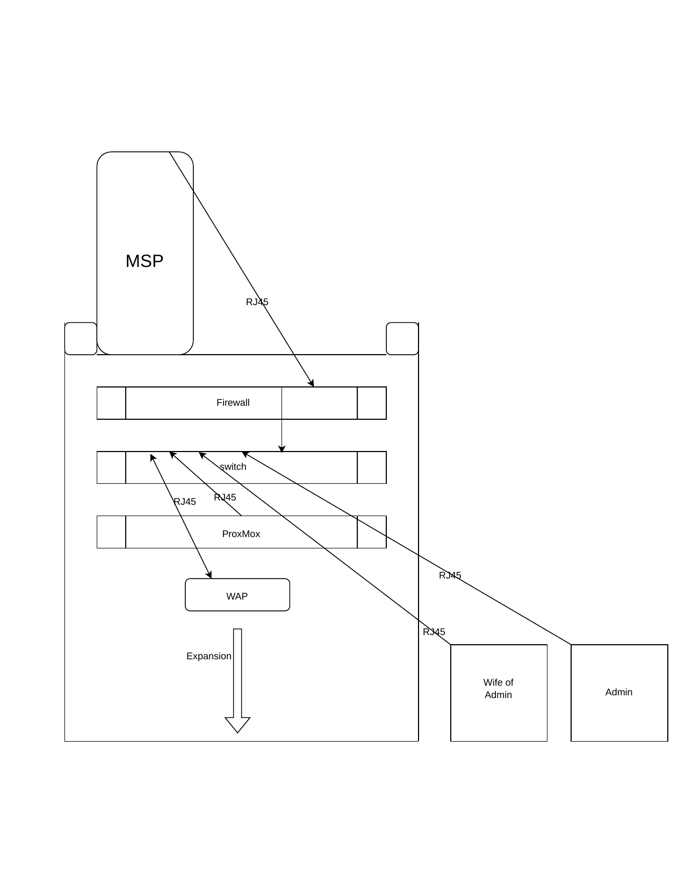

# Network — Current State

**Last verified:** 2026-11-04

The operational reference for the lab as built. This is the document to open
first when something breaks or when picking the build back up after a gap.



*Source diagram: [`home-network-topology.pdf`](home-network-topology.pdf) —
drawn in draw.io. "MSP" on the diagram is the ISP-provided Verizon 5G router.*

---

## Topology

```
Internet
   │  (5G cellular — no copper to the premises)
   ▼
Verizon 5G Router ................ 192.168.1.0/24   [ISP equipment]
   │
   │  RJ45 → OPNsense WAN (re1)
   ▼
OPNsense Firewall ................ 192.168.10.1/24  [LAN gateway, DHCP, DNS]
   │
   │  RJ45 from LAN (re0) → switch port 7
   ▼
Omada ES210X-M2 Switch ........... 192.168.10.2 · managed by the controller
   ├── port 1 → Omada EAP720 access point (192.168.10.3)
   ├── port 2 → Proxmox host (192.168.10.47)
   │              └── CT 100 · Omada controller (192.168.10.10)
   │              └── Twingate connector
   ├── port 3 → Workstation (spouse)
   ├── port 4 → Workstation (admin)
   ├── ports 5, 6, 8 → free
   └── 2× 10G SFP+ → free
```

The lab is **double-NATted** behind the Verizon router. The Twingate
connector works around this for remote access, since it dials out rather
than needing an inbound port. It will still need resolving before anything
requires a genuine inbound connection — putting the Verizon router in
bridge or IP-passthrough mode is the fix.

---

## Addressing

| Device | Address | Role | Notes |
|---|---|---|---|
| Verizon 5G router | `192.168.1.1/24` | ISP gateway | Upstream, not managed by this lab |
| OPNsense WAN (`re1`) | DHCP from upstream | WAN | Address assigned on `192.168.1.0/24` |
| OPNsense LAN (`re0`) | `192.168.10.1/24` | LAN gateway, DHCP, DNS | Web UI: `https://192.168.10.1` |
| Omada switch | `192.168.10.2/24` | Managed switch | DHCP reservation |
| Omada EAP720 AP | `192.168.10.3/24` | Access point | DHCP reservation |
| Omada controller | `192.168.10.10/24` | LXC on Proxmox (CT 100) | Web UI: `https://192.168.10.10:8043` · statically set in the container |
| Proxmox host | `192.168.10.47/24` | Hypervisor | Web UI: `https://192.168.10.47:8006` |
| DHCP pool | `192.168.10.100` – `192.168.10.199` | — | Served by Dnsmasq on OPNsense |
| Static reservations | `192.168.10.2` – `192.168.10.99` | — | Range reserved for infrastructure |

**Upstream DNS:** `1.1.1.1`, `1.0.0.1` — to be repointed at Pi-hole once that
container exists.
**Domain:** `command-center.lan`, set in both OPNsense General settings and
Dnsmasq so the two agree. A client showing this suffix confirms OPNsense is
answering DHCP rather than the upstream router.

### DHCP reservations and DNS records

Held in **Services → Dnsmasq DNS & DHCP → Hosts** on OPNsense. Addresses are
set here and **nowhere else** — the Omada controller can also assign static
IPs to adopted devices, and two sources of truth is a debugging session
waiting to happen.

| Host | FQDN | IP | MAC pinned? |
|---|---|---|---|
| Omada switch | `switch.command-center.lan` | `192.168.10.2` | yes |
| Omada AP | `ap.command-center.lan` | `192.168.10.3` | yes |
| Omada controller | `omada.command-center.lan` | `192.168.10.10` | no — static in the container, DNS record only |
| Proxmox host | `pve.command-center.lan` | `192.168.10.47` | no — static on the host, DNS record only |

The EAP720 reports no DHCP hostname, so it appears in the lease table as its
own MAC. Its OUI (`58:D8:12`) is registered to TP-Link Systems, which is how
it was identified.

---

## Physical port identification

Recorded because the logical interface names do not map predictably to the
physical jacks, and working this out cost an hour during the build.

**OPNsense box (BOSGAME E5 Plus), dual 2.5G NICs:**

| Interface | Role | Physical location |
|---|---|---|
| `re0` | **LAN** | Rear **left** viewed from the front (right when facing the rear) |
| `re1` | **WAN** | The other port |

---

## Hosts

### OPNsense firewall — BOSGAME E5 Plus

- Ryzen 5 5400U · 8GB RAM · 256GB SATA SSD
- Dual onboard Realtek 2.5G NICs
- `os-realtek-re` vendor driver package installed (see
  [troubleshooting](../troubleshooting/phase1-buildout-oct-2026.md))
- Services: routing, firewall rules, Dnsmasq DNS & DHCP, NTP
- Deliberately kept lean — Pi-hole and other services run on Proxmox, not
  on the firewall

**Hardening pass completed 2026-11-04:**
- Firmware updated
- Named admin account created with `admins` group membership; `root` retained
  as break-glass with a strong password
- Hostname `opnsense`, domain `command-center.lan`, timezone
  `America/New_York`
- NTP running against the OPNsense pool, RRD graphs enabled
- Static reservations and DNS records for all infrastructure hosts
- Config backed up to removable media. **Automated off-site backup to Google
  Drive is still to be set up** (System → Configuration → Backups → Google
  Drive)

The anti-lockout rule (Firewall → Settings → Advanced) is left enabled. It
guarantees web UI access from LAN and becomes relevant during VLAN work.

**Realtek notes carried from the driver README:**
- If interfaces enumerate but links stay down or traffic is flaky —
  particularly 2.5G into a 1G port — set `hw.re.flow_control="0"` in
  tunables.
- Network hangs with IPv6 enabled on 8125 chips are a known bug, fixed
  above firmware 1102.01.

### Proxmox host — HP EliteDesk 800 G4 Mini

- i7-8700T (6c/12t) · 32GB DDR4 (64GB ceiling) · 500GB SATA SSD, ~475GB usable
- Proxmox VE 9.2, ext4 on `/dev/sda`
- Hostname: `pve` · Timezone: `America/New_York`
- Repository: switched from `pve-enterprise` to **no-subscription**
- Bridge: `vmbr0` → `192.168.10.47/24`, gateway `192.168.10.1`

**Guests:**

| ID | Name | Type | Address | Purpose |
|---|---|---|---|---|
| 100 | `omada` | LXC, Debian 12 | `192.168.10.10` | Omada controller |
| — | `twingate-connector` | guest | DHCP | Twingate remote access (Phase 2, started early) |

### Omada controller — CT 100

- Debian 12 LXC, unprivileged · 2 cores · **4GB RAM / 1GB swap** · 16GB disk
- Omada Network Application **v6.3.0.45**
- OpenJDK 17 (Debian 12 default — sufficient below controller v6.4.0)
- MongoDB 8.0.34 from MongoDB's own apt repository
- Web UI: `https://192.168.10.10:8043` · HTTP listener on `:8088`
- Service control: `tpeap start` / `tpeap status` / `tpeap stop`

**2GB was not enough.** The original spec starved it — the Java heap plus
MongoDB plus the OS exceeded 2GB and the container thrashed without ever
finishing first-run initialization. See
[troubleshooting](../troubleshooting/omada-controller-lxc.md).

### Omada ES210X-M2 switch

- 8× 2.5GbE, 2× 10G SFP+, fanless, VLAN-capable, managed
- **Not PoE** — the EAP720 is powered by its own DC adapter
- **Adopted** into the controller (2026-10-29)

### Omada EAP720 access point

- BE5000 Wi-Fi 7, dual band, 2.5G uplink
- DC-adapter powered
- Powered and pulling DHCP, but **not yet adopted or configured**

---

## Known issues and next steps

| Item | Status | Note |
|---|---|---|
| EAP720 adoption | **Next** | Controller is up and the switch is adopted; the AP is the remaining device |
| VLAN segmentation | **Next major task** | Two-sided job across OPNsense and the Omada controller — budget a real block of time |
| Proxmox hostname is bare `pve` | **To fix** | Should be a proper FQDN. See below |
| BIOS "After Power Loss" | **To change** | Currently `Power Off`; should be `Power On` so the node returns after an outage |
| Automated config backup | **To set up** | OPNsense → Google Drive. Backups are currently manual to removable media |
| Pi-hole | Not started | Then repoint OPNsense DHCP DNS at it |
| Uptime Kuma | Not started | Monitoring before agents — alerts need something to alert on |
| Hermes VM | Not started | Phase 3 AI groundwork |
| Double NAT | Accepted for now | Revisit before inbound access; the Twingate connector works around it for remote access |
| Patch panel / PDU / fan panel | Deferred | See [parts list](../hardware/parts-list.md) |

### Adoption order — important

Omada devices can be managed **either** standalone from the phone app **or**
by a controller, not both. A device adopted standalone must be factory reset
before it can join a controller. Stand up the controller container first,
then adopt the switch and AP into it once.

### Fixing the Proxmox hostname

The installer recorded a bare `pve` rather than an FQDN. To correct it:

```bash
hostnamectl set-hostname pve.command-center.lan
```

Then update `/etc/hosts` so the address line matches:

```
192.168.10.47   pve.command-center.lan pve
```

A `.lan` suffix is preferable to `.local` (claimed by mDNS/Bonjour) or a
real ccTLD such as `.pr`.

---

## Build sequence from here

1. Adopt the EAP720 into the controller and configure SSIDs
2. Fix the Proxmox hostname and the BIOS power-loss setting
3. **VLAN segmentation** — design the scheme, create interfaces and DHCP
   scopes on OPNsense, write inter-VLAN rules, and configure matching
   trunk/access ports in the Omada controller
4. Pi-hole LXC → repoint OPNsense DHCP DNS
5. Uptime Kuma LXC (monitoring before agents — alerts need something to
   alert on)
6. Hermes VM
